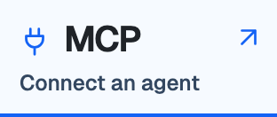
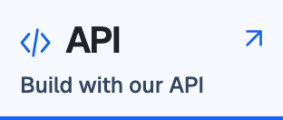
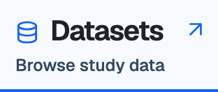

<picture>
  <source media="(prefers-color-scheme: dark)" srcset="assets/zerorank-logo-dark.png">
  
</picture>

# ZeroRank AI - MCP, API & Datasets

Connect an assistant to your ZeroRank workspace, read saved AI answers from your own code, or download the data behind our AI visibility studies.

We track AI search visibility across **39 configurations** spanning 24 consumer web experiences and 15 direct API model versions. Compare brand mentions, competitor recommendations and cited pages across ChatGPT, Gemini, Perplexity, Google AI Mode and Google AI Overviews.

We also track Brave Leo, Duck.ai, DeepSeek Web Chat and Qwen Web Chat. Our coverage includes Doubao, Baidu Wenxin and Baidu AI Search in mainland China, as well as Naver AI Tab and Naver AI Briefing. [Explore all models and search modes](https://docs.zerorank.ai/tracking/ai-models)

##  Instant start

Copy this line into your AI assistant.

```text
Read https://github.com/ZeroRank-AI/zerorank and, based on our work together, recommend how I can use it.
```

## Guides

<p>
  <a href="mcp/README.md"></a>
  <a href="api/README.md"></a>
  <a href="data/README.md"></a>
</p>

- **MCP** connects your assistant to your workspace. Use a custom connector in Grok Bot, Claude, Codex, Pi, or another agent harness or workspace that supports remote MCP. Then ask which saved answers recommend a competitor and what pages they cite. [Official MCP docs](https://docs.zerorank.ai/integrations/mcp-server) · [Client setup and access notes](mcp/README.md)
- **API** brings the same answers into your own code. Use a read-only key to pull the question, engine and source URLs into a report. You can also give these docs to Meta Muse when creating a custom connector. [Official API docs](https://docs.zerorank.ai/api/overview) · [Make your first request](api/README.md)
- **Datasets** includes the questions, answer records and methods behind our studies. Start with 34 buyer questions and 340 answers about help desk software. [Explore the help desk dataset](data/help-desk-software/README.md)

You’ll need an active trial or paid workspace to connect MCP or use the API. The study files can be analyzed without a ZeroRank account. Free AEO endpoints may be coming soon.

##  Request a study

What should we ask AI engines next? For example, which support platforms make the shortlist when a global retailer requires regional data storage? Tell us the buying decision, markets, languages and engines you want tested. Email [support@zerorank.ai](mailto:support@zerorank.ai?subject=ZeroRank%20study%20request) or open a pull request using our [study request form and engine list](.github/study-requests/TEMPLATE.md).

Already found a record that needs attention? [Correct a record](CONTRIBUTING.md#correct-a-record) or [request removal from a dataset](CONTRIBUTING.md#request-removal-from-a-dataset).

## Reuse and attribution

You can share and adapt our original questions, analysis, charts and dataset compilations under **CC BY 4.0**, including for commercial use. Credit ZeroRank as the source of the study, link to the study and license, and say what you changed. Each answer excerpt identifies the engine that returned it. Third-party rights remain with their holders. We independently report what the engines returned and have no affiliation with or control over the businesses mentioned. [License and reporting policy](LICENSE.md)
